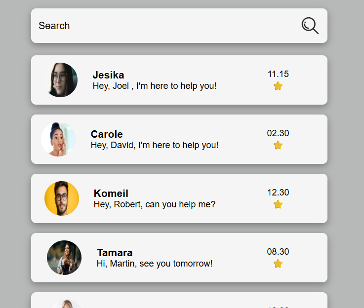

# 📱 React Contact List

A simple React contact list application created as part of my React learning journey.

This project focuses on practising functional components, props, reusable components, JSX, and dynamic rendering using the JavaScript `map()` method.

## 🌐 Live Demo

[](https://react-contact-list-neon.vercel.app/)

## 📸 Screenshot

<p align="center">
  
</p>

## ✨ Features

- 👥 **Contact List:** Displays multiple contacts in an organised layout.
- 🧩 **Reusable Components:** Uses reusable React components to display contact information.
- 📦 **Props:** Passes contact details from parent components to child components.
- 🔄 **Dynamic Rendering:** Uses JavaScript `map()` to render contacts from an array.
- 🎨 **CSS Styling:** Provides a styled contact list interface.

## ⚛️ Concepts Practiced

- ⚛️ React Functional Components
- 📦 Props
- 🧩 Component Reusability
- 🔄 JavaScript `map()` Method
- 📝 JSX
- 🖼️ Importing Images into React
- 🎨 CSS Styling

## 🛠️ Technologies Used

- React.js
- JavaScript
- JSX
- CSS

## 🚀 Run Locally

1. Clone the repository:

   ```bash
   git clone https://github.com/inthusha20241647-commits/react-contact-list.git
   ```

2. Navigate to the project directory:

   ```bash
   cd react-contact-list
   ```

3. Install dependencies:

   ```bash
   npm install
   ```

4. Start the development server:

   ```bash
   npm start
   ```

5. Open your browser at `http://localhost:3000`.

## 🎯 Learning Objective

The main objective of this exercise was to understand how props pass data between React components and how the JavaScript `map()` method dynamically renders multiple contact items from an array.

---

*This project is part of my continuous learning journey in React and frontend development.*
